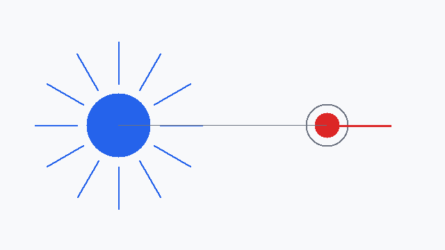

# 电场与检验电荷

## 电荷之间的相互作用是怎么传递的

两个电荷不接触也能互相施力。为解释这一点，课上把「电荷在其周围激发电场，电场再对放入其中的电荷施力」作为图像。这个图像本身不可测量，方便之处是它把超距作用换成了局域作用。

## 电场强度的定义

$$
\vec{E} = \frac{\vec{F}}{q_0}
$$

其中 $\vec{F}$ 是电场对检验电荷的作用力（单位 N），$q_0$ 是检验电荷的电量（单位 C），所以 $\vec{E}$ 的单位是 N/C，等价于 V/m。

> [!warning] 定义式的适用条件
> 该式对任何静电场都成立，它不做任何电荷分布上的假设；但它只告诉我们「怎么测」场强，不告诉我们「场强由什么决定」。决定式见 [[第1章-静电场/1-1-电场强度/02-点电荷场强叠加|02-点电荷场强叠加]]。

## 检验电荷要满足什么

| 要求 | 原因 |
| --- | --- |
| 电量足够小 | 否则它自己激发的电场会改变原场的分布 |
| 体积足够小 | 否则测到的是一个小区域内的平均效果，不是该点的场 |

> [!note] 视频 03:40：屏幕上把检验电荷写成 $q_0$ 并强调「小」有两层含义，口述里补充了「点」这一层。这里把两层都列出来，标注为口述补充。

> [!question]- 自测
> 1. 把检验电荷电量放大一倍，测得的 $\vec{E}$ 会不会跟着变？
>    - 不会。$\vec{F}$ 同比增大，比值不变——前提是放大后的电荷仍能近似当作检验电荷。
> 2. 定义式和决定式的分工是什么？
>    - 定义式给测量方法且普适；决定式把场强落到源电荷与几何上，只对特定分布成立。
