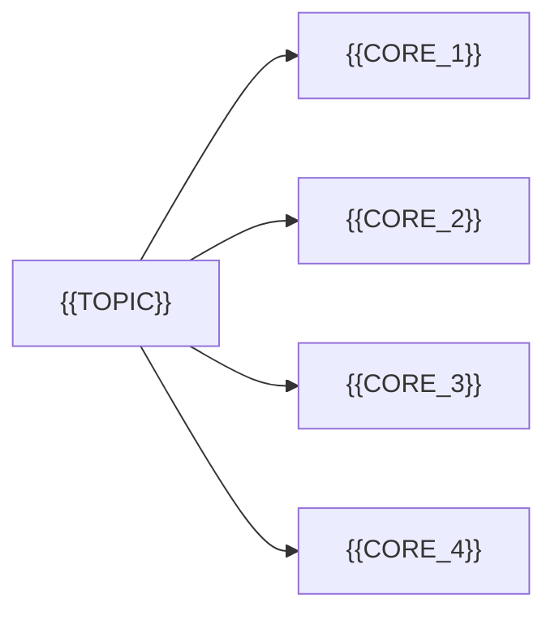

# 第 {{NN}} 讲 {{TITLE}} · 视频讲解

> [!info] 课程信息
> - 课程：{{COURSE}}
> - 视频：[{{TITLE}}]({{SOURCE}})（{{DURATION}}）
> - 上一讲：{{PREV}}
> - 下一讲：{{NEXT}}
> - 配套扩展：[[第{{NN}}讲-{{TOPIC}}/02-扩展笔记|02 · 扩展笔记]]
> - 返回：[[00-课程索引]]

> [!abstract] 本讲导航
> - [[#0. 本讲在课程中的位置]]
> - [[#视频讲述内容总结（字幕精华）]]
> - [[#1. 为什么需要{{TOPIC}}]]
> - [[#2. {{TOPIC}}是什么]]
> - [[#3. {{TOPIC}}的核心内容]]
> - [[#4. 视频里的图与表]]
> - [[#5. 视频里的示例]]
> - [[#6. 截图索引]]

> [!summary] 一句话总结
> **{{ONE_LINE_SUMMARY}}**

---

## 0. 本讲在课程中的位置

| 讲次 | 主题 | 与本讲的关系 |
|---|---|---|
| {{PREV_LECTURE}} | {{PREV_TITLE}} | 上一讲 |
| **第 {{N}} 讲** | **{{TITLE}}** | **本讲** |
| {{NEXT_LECTURE}} | {{NEXT_TITLE}} | 下一讲 |

{{POSITION_NOTE}}

---

## 视频讲述内容总结（字幕精华）

> 基于视频口播字幕提炼，按讲师讲述顺序整理；括号内为对应的大致时间段。

> [!abstract] 30 秒速览
> 这段视频回答三个问题：
> 1. **是什么**：{{WHAT}}
> 2. **为什么**：{{WHY}}
> 3. **怎么做**：{{HOW}}

### 按讲述顺序的 8 条精华

1. **开场（00:00）**：{{POINT_1}}
2. **概念/类比（00:xx）**：{{POINT_2}}
3. **定义（01:xx）**：{{POINT_3}}
4. **必要性（0x:xx）**：{{POINT_4}}
5. **核心作用/步骤（0x:xx）**：{{POINT_5}}
6. **关键图/表（0x:xx）**：{{POINT_6}}
7. **示例/字段（0x:xx）**：{{POINT_7}}
8. **收尾（0x:xx）**：{{POINT_8}}

> [!tip] 本节最值得记住的 5 个点
> - {{KEY_1}}
> - {{KEY_2}}
> - {{KEY_3}}
> - {{KEY_4}}
> - {{KEY_5}}

> [!success] 一句话记住
> **{{MEMORY_LINE}}**

---

## 1. 为什么需要{{TOPIC}}

{{WHY_SECTION}}


*视频 {{IMG1_TIME}} 左右：{{IMG1_CAPTION}}。*

| 概念 | 作用 | 备注 |
|---|---|---|
| {{CONCEPT_1}} | {{CONCEPT_1_DESC}} | {{CONCEPT_1_NOTE}} |
| {{CONCEPT_2}} | {{CONCEPT_2_DESC}} | {{CONCEPT_2_NOTE}} |

---

## 2. {{TOPIC}}是什么

视频给出的定义：

> **{{DEFINITION}}**


*视频 {{IMG2_TIME}} 左右：{{IMG2_CAPTION}}。*

{{WHAT_SECTION}}

---

## 3. {{TOPIC}}的核心内容

{{CORE_INTRO}}



### 3.1 {{CORE_1}}

{{CORE_1_TEXT}}

### 3.2 {{CORE_2}}

{{CORE_2_TEXT}}

### 3.3 {{CORE_3}}

{{CORE_3_TEXT}}

### 3.4 {{CORE_4}}

{{CORE_4_TEXT}}

---

## 4. 视频里的图与表


*视频 {{IMG3_TIME}} 左右：{{IMG3_CAPTION}}。*

{{TABLE_INTRO}}

| {{COL1}} | {{COL2}} | {{COL3}} | {{COL4}} |
|---|---|---:|---|
| {{ROW1}} | {{ROW1B}} | {{ROW1C}} | {{ROW1D}} |
| {{ROW2}} | {{ROW2B}} | {{ROW2C}} | {{ROW2D}} |

{{TABLE_NOTE}}

---

## 5. 视频里的示例


*视频 {{IMG4_TIME}} 左右：{{IMG4_CAPTION}}。*

```{{CODE_LANG}}
{{CODE_EXAMPLE}}
```

{{CODE_NOTE}}

---

## 6. 截图索引

| 图片 | 视频时间 | 内容 |
|---|---|---|
| `{{NN}}-01_{{IMG1_NAME}}.png` | {{IMG1_TIME}} | {{IMG1_CAPTION}} |
| `{{NN}}-02_{{IMG2_NAME}}.png` | {{IMG2_TIME}} | {{IMG2_CAPTION}} |
| `{{NN}}-03_{{IMG3_NAME}}.png` | {{IMG3_TIME}} | {{IMG3_CAPTION}} |
| `{{NN}}-04_{{IMG4_NAME}}.png` | {{IMG4_TIME}} | {{IMG4_CAPTION}} |

> [!note] 资料来源
> - 视频：{{COURSE}} 第 {{N}} 讲
> - 字幕：本地 SenseVoice（sherpa-onnx）转写，原始转写可能有同音字，本笔记已按幻灯片校正术语。
> - 截图：1080P 原片按需截取，仅用于个人学习笔记。
> - 原始字幕：[第{{NN}}讲_字幕原文.txt](assets/第{{NN}}讲_字幕原文.txt)
