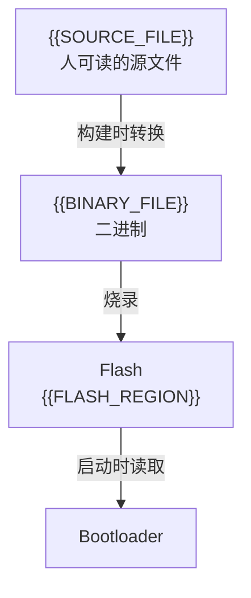
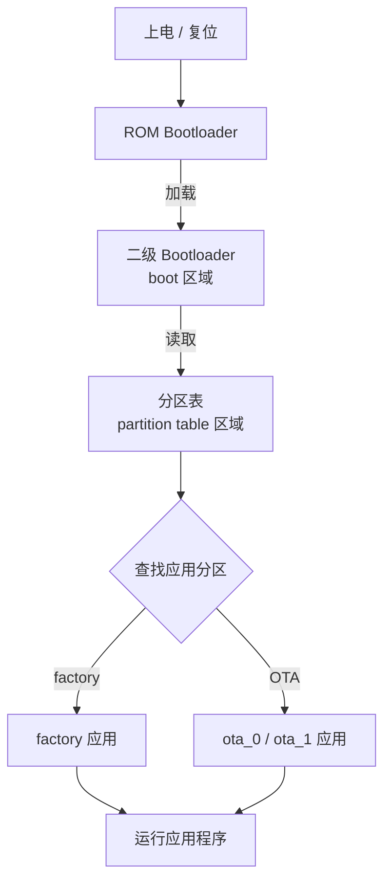

# 第 {{NN}} 讲 {{TITLE}} · 扩展笔记

> [!info] 配套笔记
> - 视频讲解：[[第{{NN}}讲-{{TOPIC}}/01-视频讲解|01 · 视频讲解]]
> - 本笔记只放**视频之外的扩展**：概念补强、地址计算、启动流程、代码 API、常见坑、自测题。
> - 返回：[[00-课程索引]]

> [!abstract] 本讲导航
> - [[#1. 概念补强]]
> - [[#2. 地址与容量计算]]
> - [[#3. 启动流程]]
> - [[#4. OTA 分区扩展]]
> - [[#5. 代码里怎么用]]
> - [[#6. 常见坑与检查清单]]
> - [[#7. 自测题]]
> - [[#8. 命令速查]]

> [!summary] 扩展目标
> {{EXTENSION_GOAL}}

---

## 1. 概念补强

### 1.1 {{EXTRA_CONCEPT_1}}

{{EXTRA_CONCEPT_1_TEXT}}

### 1.2 {{EXTRA_CONCEPT_2}}

{{EXTRA_CONCEPT_2_TEXT}}

### 1.3 从源文件到 Flash



---

## 2. 地址与容量计算

### 2.1 十六进制换算

| 十六进制 | 十进制 | 常见说法 |
|---:|---:|---|
| `0x1000` | 4,096 | 4KB |
| `0x10000` | 65,536 | 64KB |
| `0x100000` | 1,048,576 | 1MB |
| `0x1000000` | 16,777,216 | 16MB |

### 2.2 总容量检查

```text
{{SIZE_SUM}}
```

### 2.3 起止地址反推大小

> **Size = 结束地址 − 起始地址**

| 分区 | 起始 | 结束 | 计算 | 大小 |
|---|---:|---:|---|---:|
| {{PART}} | {{START}} | {{END}} | `{{END}} − {{START}}` | `{{SIZE}}` |

### 2.4 对齐要求

> [!warning] 偏移不是随便填的
> {{ALIGNMENT_NOTE}}

---

## 3. 启动流程



{{BOOT_FLOW_NOTE}}

### 各分区丢失后的影响

| 分区 | 放什么 | 擦掉/丢失后的影响 |
|---|---|---|
| {{BOOT_PART}} | {{BOOT_CONTENT}} | {{BOOT_EFFECT}} |

---

## 4. OTA 分区扩展

| 分区 | Type / SubType | 作用 |
|---|---|---|
| `otadata` | `data` / `ota` | 记录当前从哪个 OTA 分区启动 |
| `ota_0` | `app` / `ota_0` | 第一个 OTA 应用槽 |
| `ota_1` | `app` / `ota_1` | 第二个 OTA 应用槽 |
| `factory` | `app` / `factory` | 出厂固件，可选 |

{{OTA_NOTE}}

---

## 5. 代码里怎么用

### 5.1 {{API_1}}

```c
{{API_1_CODE}}
```

{{API_1_NOTE}}

### 5.2 {{API_2}}

```c
{{API_2_CODE}}
```

{{API_2_NOTE}}

---

## 6. 常见坑与检查清单

### 6.1 常见报错

| 现象 | 常见原因 | 处理 |
|---|---|---|
| {{ERR_1}} | {{ERR_1_CAUSE}} | {{ERR_1_FIX}} |
| {{ERR_2}} | {{ERR_2_CAUSE}} | {{ERR_2_FIX}} |

### 6.2 烧录前检查清单

- [ ] {{CHECK_1}}
- [ ] {{CHECK_2}}
- [ ] {{CHECK_3}}
- [ ] {{CHECK_4}}

---

## 7. 自测题

> [!question]- 1. {{QUESTION_1}}
> {{ANSWER_1}}

> [!question]- 2. {{QUESTION_2}}
> {{ANSWER_2}}

> [!question]- 3. {{QUESTION_3}}
> {{ANSWER_3}}

---

## 8. 命令速查

```bash
{{COMMANDS}}
```

> [!note] 返回
> - 视频讲解：[[第{{NN}}讲-{{TOPIC}}/01-视频讲解|01 · 视频讲解]]
> - 课程索引：[[00-课程索引]]
